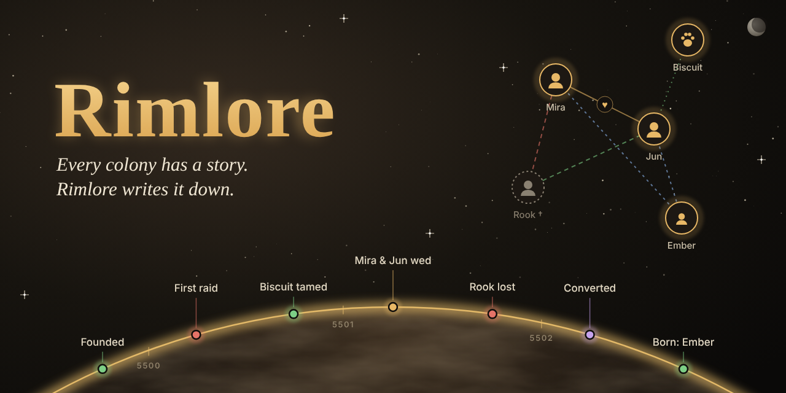
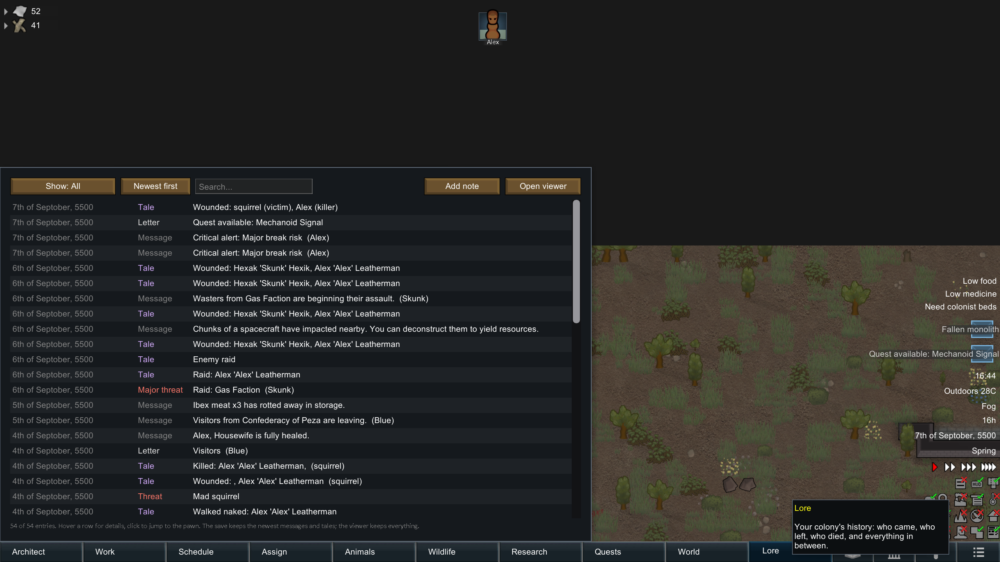
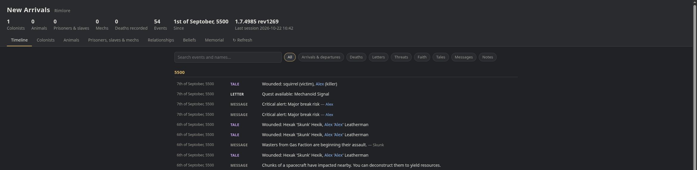
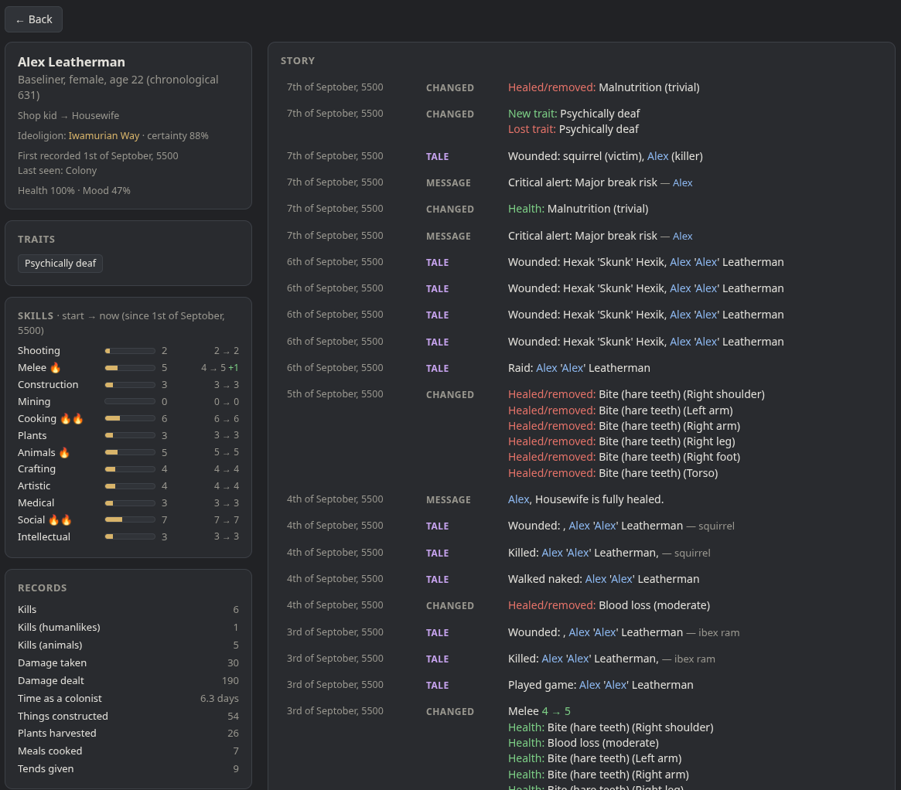
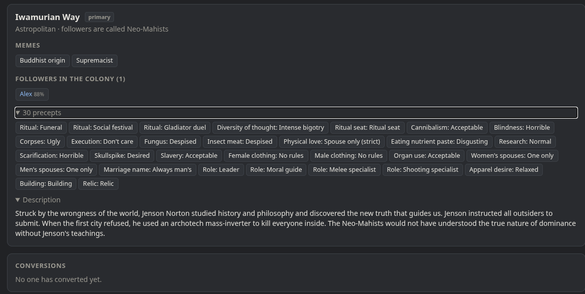

# Rimlore



*Every colony has a story. Rimlore writes it down.*

I wanted a way to look back on my old colonies and remember the people, animals and events that made them what they were. That's why I made Rimlore.

Rimlore keeps a running history of your colony as you play. From the first colonist to the last, it records what happened, who came and went, and how your colony changed over time.

You can explore that history in-game or open it in your browser, even long after you've stopped playing that colony.

## What Rimlore records

- **Arrivals and departures:** Births, recruits, tamed animals, captures, deaths, escapes and sales. It also recognises returning pawns and resurrections.
- **Events:** Every letter the game sends you, with optional messages and tales.
- **Pawn development:** Changes to skills, passions, traits, injuries, scars, relationships and animal training.
- **Relationships:** Couples, families, friendships, rivalries, animal bonds and how pawns feel about each other.
- **Ideology:** Conversions, changes to an ideoligion's memes and precepts, and who follows each belief. Requires Ideology.
- **Personal notes:** Select a pawn, click **Add note**, and write down anything you want to remember.

Rimlore follows colonists, prisoners, slaves, mechs and animals, not just the people currently living in your colony.

## Exploring your colony's history

There are two ways to read everything Rimlore has recorded.

### In-game

Rimlore adds a **Lore** button next to History on the bottom bar.

From there, you can browse your colony's timeline, search and filter events, or show only entries related to your selected pawns. Clicking an entry can also take you straight to the pawn involved.

### Browser viewer

Click **Open viewer** from the Lore tab to open your colony's history in your browser.

The viewer has several sections:

- **Timeline:** Browse events by year, with search and filters.
- **Colonists:** Individual profiles for your pawns and animals, including their personal histories.
- **Relationships:** Explore families, couples, friends, rivals and animal bonds, including when connections began or ended.
- **Beliefs:** See each ideoligion's followers, memes, precepts and conversions.
- **Memorials:** Look back on pawns and animals you've lost.

The viewer works offline, so you don't need to run a web server or keep RimWorld open to read your history.

While you're playing, Rimlore continues adding new entries. Click **↻ Refresh** in the viewer to load the latest records.

## How it works

Rimlore reads information that RimWorld already provides and provides a better overview of your colony and its history.

A few things are worth knowing:

- **Existing saves:** You can add Rimlore to an existing colony. It will recover whatever history the game still remembers, although not every type of historical data has been fully tested.
- **Changes over time:** Some information can only be tracked from when you install Rimlore. For example, skill progress starts from Rimlore's first run and will not display the skill level from the beginning of the save.
- **Reloading saves:** When you load an earlier save, entries from the abandoned timeline are marked as *rewound* rather than being mixed into the new history. This still needs further testing and needs a rework on the toggle.
- **History storage:** Only the newest messages and tales are kept in the game save. The full chronicle is stored separately, so older records can still be revisited.

## Screenshots









## Installing

**Steam Workshop:** [Rimlore](https://steamcommunity.com/sharedfiles/filedetails/?id=3824287329)

**From GitHub:** Download `Rimlore.zip` from [Releases](../../releases), extract it into your RimWorld `Mods` folder, then enable Rimlore in the mod list.

| System | Usual Mods folder (Steam) |
|---|---|
| Linux | `~/.local/share/Steam/steamapps/common/RimWorld/Mods` |
| Windows | `C:\Program Files (x86)\Steam\steamapps\common\RimWorld\Mods` |
| macOS | `~/Library/Application Support/Steam/steamapps/common/RimWorld/RimWorldMac.app/Mods` |

If RimWorld is installed in another Steam library, use the equivalent path inside that library.

## Where your history is kept

Rimlore stores each colony's history in a `Rimlore` folder alongside your `Saves` folder.

You can find the exact location under **Options → Mod settings → Rimlore**.

```text
Rimlore/<Colony name>_<id>/
    chronicle-data.js   The history, updated as you play
    index.html          The offline browser viewer
```

The history consists of JSON records, one per line, wrapped as `C({...});` so the viewer can read them directly without a web server.

If you want to use the data in your own scripts, you can remove the `C(` and `);` wrapper from each record.

## Building from source

You'll need the [.NET 10 SDK](https://dotnet.microsoft.com/download).

```sh
./release.sh                      # Build into dist/Rimlore and create dist/Rimlore.zip
./release.sh <RimWorld>/Mods/Rimlore  # Build directly into your Mods folder
```

## Licence

Rimlore is free and open-source software licensed under the [GNU General Public License v3.0](LICENSE).
You are free to use, modify, fork and share Rimlore. Any derivative versions you distribute must also be licensed under GPLv3, with their source code made available under the same terms.

I believe open-source software benefits everyone, and I wish more developers and companies embraced it. I encourage anyone interested in Rimlore to experiment with new ideas and to add their own personal touch.

At its heart, Rimlore is about creativity, enjoyment and learning. I hope this project gives you something to build upon, learn from and share with others or to just sit back and enjoy using.

The GPLv3 licence helps preserve that spirit by ensuring that improvements and derivative works remain open for others to explore, modify and build upon.

**Ultimately, I want Rimlore to be something people can enjoy, learn from and make their own if desired.**
